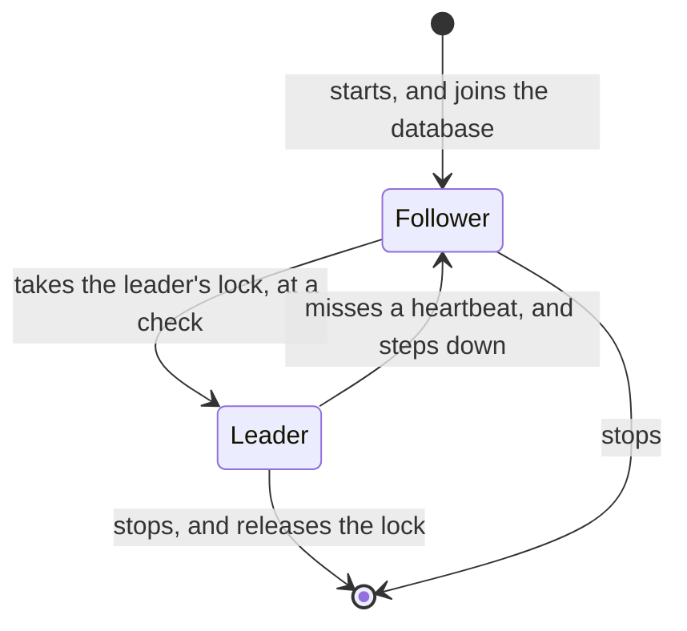

# How nbpdns replicas choose a leader

On PostgreSQL, several `nbpdns serve`s can share one database, as
replicas. Each serves the API and the status page, from the database. One
of them, the leader, does the work that must happen once: it refreshes the
drift report and prunes the database, and from M14 it writes to PowerDNS.
This page explains how the replicas choose the leader, how they replace one
that's lost, and why two never lead at once.
[Run several replicas of nbpdns](../how-to/run-several-replicas-of-nbpdns.md)
sets them up.

[ADR-0047](../adr/0047-elect-the-leader-with-a-postgresql-session-advisor.md)
and [ADR-0049](../adr/0049-end-a-lost-replica-s-write-transaction-after-20-se.md)
record the decisions, and
[ADR-0048](../adr/0048-replicas-share-their-state-through-the-database.md)
how the replicas share their state.

## One lock, held by one session

The leader is the replica that holds the leader's lock: a PostgreSQL
session advisory lock, which one session at a time can hold. Its key comes
from the database's ID, so two installs that share a server never share
it.

- Each replica opens a session of its own as it starts, on a connection
  apart from the ones it reads and writes through, and holds its locks
  there.
- A session advisory lock lasts as long as its session, however the
  session ends. A replica that stops, or dies, ends its session, and
  PostgreSQL frees the lock at once.
- The replica that takes the lock writes the leader's row, in the same
  transaction as a `service.leader_acquired` audit event. The row holds its
  name, which is its host's, a random ID from its start, when it took over,
  when it last confirmed that it leads, and when its next refresh is due.
  The event holds the leader before it, and when that leader was last seen.
- A new leader refreshes at once, comparing every zone. That covers
  anything that the leader before it left undone, such as NetBox's
  webhooks that it hadn't yet refreshed.

Every replica's `/status` names the leader from its row, and
`nbpdns_leader` is 1 on the leader alone.

## Followers try at each check

The followers don't wait for the lock: each one tries for it at each of its
checks of the database, every `database.poll_interval`, 5 seconds by
default, and carries on following if another session holds it.

A leader that stops releases the lock, and sends a notification. With
`database.listen` on, each follower checks at once when notified, so one of
them takes over within milliseconds. Without it, one takes over at its next
check. A leader that dies sends nothing, but its connection closes, so the
lock is free by the next check.

## A lost leader's lock lasts about 30 seconds

A host that dies, or a network that fails, closes nothing: by PostgreSQL's
defaults, a lost session, and its lock, can last for hours. So the leader's
session sets timeouts of its own, which end it once the leader is lost:

| Setting | Value | Ends the session of |
|---|---|---|
| `tcp_keepalives_idle`, `tcp_keepalives_interval`, `tcp_keepalives_count` | 10 s, 5 s, 3 | A host that died, or a network that failed: about 25 seconds after the session's last query. |
| `tcp_user_timeout` | 25 s | A host that no longer acknowledges what PostgreSQL sends it. |
| `idle_session_timeout` | 30 s | A process that hangs, whose kernel still answers the keepalives: 30 seconds after its last query. |

Once PostgreSQL ends the session, the lock is free, and a follower takes it
at its next check.

## The leader steps down first

A leader that's cut off from the database may not know it. Another replica
could take the lock while it still refreshes. So the leader confirms its
lead every 5 seconds: it updates its row, on its session, and waits at most
5 seconds for that. If it can't, it steps down: it stops its refresh and the
prune, closes its session, and follows. It logs `the leader missed its
heartbeat, so this replica steps down`.

That's within 10 seconds of its last confirmation. PostgreSQL can't free
the lock sooner than about 20 seconds after the loss, since the leader's
last query was at most 5 seconds before it. So the old leader has stopped
leading before another can start. In the integration tests, a leader cut
off by a proxy that keeps its sockets open steps down about 9 seconds after
the cut, and another takes over about 29 seconds after it.

## A fence on the leader's writes

A leader can lose its lock without stepping down: a process that hangs, or
that the host pauses, misses its heartbeats without running at all. When it
resumes, it could write before its next heartbeat fails.

So each of the leader's writes checks, in its own transaction, that the
leader's session still holds the lock, by the session's backend in
`pg_locks`. A write by a replica that lost the lock fails, and writes
nothing. The leader's writes are a refresh's history, the prune, and
taking the webhooks' queue, and from M14 the record of each write to
PowerDNS.

## Writes take turns

Every write to the database, by any replica or the command line, holds a
second lock for its transaction, so that writes run one at a time. A
replica lost in the middle of a write would hold that lock: until it
resumes, or across a lost network, for hours. So PostgreSQL ends a write
whose replica sends nothing for 20 seconds, which frees the lock. That's no
later than it frees a lost leader's lock, so the new leader can record its
takeover, and the other writers carry on. A replica that resumes finds its
write undone.

## How long a takeover takes

| The leader | Another takes over | Measured in the lab |
|---|---|---|
| Stops cleanly, such as on SIGTERM | At the next check, or at once with `database.listen` | 2.3 s with a 5-second poll, 0.1 s with `database.listen` |
| Dies, such as on SIGKILL | At the next check | 2.4 s |
| Hangs, such as on SIGSTOP | About 30 seconds after its last query, then at the next check | 29.7 s |
| Loses its network | About 30 seconds, then at the next check; it steps down first, within 10 seconds | Stepped down at 8.6 to 8.8 s, replaced at 28.8 to 29 s |
| Loses its host | About 25 seconds, then at the next check | — |

Until then, the followers go on serving the last refresh that the leader
wrote, and taking NetBox's webhooks, which wait in the database for the new
leader. While a lost replica's write holds the write lock, for up to 20
seconds, they answer a webhook with `503`, and the new leader's first
refresh finds the change.

## What it doesn't do

- **SQLite:** a SQLite database has one `serve`, which always leads, under
  its file lock.
- **A pooler in transaction mode:** the locks need sessions of their own.
  nbpdns connects directly, or through a pooler in session mode.
- **Several regions, or PostgreSQL's read replicas:** every replica reads
  and writes one database.
