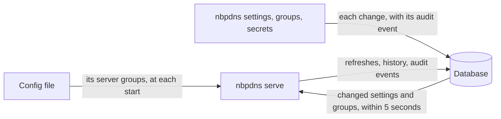

# How nbpdns stores its state

`nbpdns serve` keeps its state in a database: the runtime settings, the
server groups, the secrets it stores, the audit trail, and the drift history
of each refresh and each zone. This page explains how that database is
built, what is in it, and what protects it. It doesn't hold NetBox's
records: they're a cache, which the first refresh after a restart reads
again. The one-shot commands, such as `nbpdns drift`, need no database.

[ADR-0038](../adr/0038-an-embedded-sqlite-store-with-goose-and-sqlc.md),
[ADR-0039](../adr/0039-a-hash-chained-audit-trail.md),
[ADR-0040](../adr/0040-runtime-settings-and-managed-resources.md),
[ADR-0041](../adr/0041-secrets-encrypted-at-rest.md),
[ADR-0042](../adr/0042-drift-history.md) and
[ADR-0045](../adr/0045-rename-a-server-group-by-moving-its-name-keyed-row.md)
record the decisions.

## One file, one serve

The database is SQLite, embedded in the binary through the pure-Go driver
modernc.org/sqlite. A driver that needs a C compiler would end the static
binary, and with it the single file that
[ADR-0009](../adr/0009-persistence-and-high-availability.md)
promises. `database.url` says where the file is, by default
`sqlite:///var/lib/nbpdns/nbpdns.db`.

- nbpdns creates the file readable and writable by its owner only. SQLite
  gives the files it makes beside it the same permissions.
- The database is in WAL mode, with `synchronous(FULL)` and a busy timeout
  of 5 seconds. A write waits that long for another to finish, so the
  command line can write while `serve` runs.
- `serve` takes an exclusive `flock` on `<database>.lock` before it opens the
  database. Only one `serve` may use a database: two would each compare,
  record and prune on their own. A second one refuses to start, and its error
  names the first one's host and PID.
- The kernel releases the lock if `serve` dies, however it dies, so a crash
  leaves nothing to clean up. The lock file stays.
- The command line's writes, such as `nbpdns settings set`, don't take the
  lock: that is how they work while `serve` runs. `nbpdns db migrate` and
  `nbpdns secrets rotate-master-key` do take it, and refuse while `serve`
  runs.

The database can be PostgreSQL 18 instead, when `database.url` is a
`postgres://` URL, as [Run nbpdns on PostgreSQL](../how-to/run-nbpdns-on-postgresql.md)
sets up. It holds the same tables, from the same migrations, and one `serve`
uses it at a time too: `serve` holds a session advisory lock in the
database, which PostgreSQL releases when the session ends, however it ends.
[ADR-0046](../adr/0046-the-store-on-postgresql-18-with-pgx-and-a-second-s.md)
records the decision.

## Migrations

The schema is built by migrations, which are SQL files embedded in the
binary, and applied in order by [goose](https://github.com/pressly/goose). `serve` applies the
ones the database lacks when it starts, each in its own transaction, and logs
each. `nbpdns db status` shows which are applied, and `nbpdns db migrate`
applies them without starting `serve`.

Migrations only move forward. A newer release can migrate a database, but an
older one refuses a database that a newer one migrated. To go back to an
older release, restore a copy of the database that was made before the
upgrade. [Back up nbpdns's database](../how-to/back-up-nbpdns-database.md)
shows how. The same SQL runs on SQLite and PostgreSQL: `make generate`
makes the queries' code for each database from it, `make check` fails if
either is stale, and a test refuses SQLite's own functions.

## Settings in the database

Each key is either a runtime key or a bootstrap key. A runtime key, such as
`drift.interval`, is one that `serve` can apply while it runs, and can be
stored in the database. A bootstrap key isn't, because changing it while
`serve` runs, from where settings are changed, would break nbpdns, or could
turn it against you:

- `database.url` and `database.master_key` open the database and its
  secrets, so they can't be inside it.
- `server.*`, `log.format` and `otlp.*` set up the listener, the log, and
  the traces, which `serve` makes once, as it starts.
- `netbox.url` and `netbox.ca_file` decide where nbpdns sends its NetBox
  token, and whom it trusts with it. `netbox.token` is a runtime key, so
  whoever can change settings can replace the token, but can't send it to
  another host.

[Configuration sources and precedence](configuration-sources-and-precedence.md)
explains how the database fits among the sources, and what it means for a
runtime key to be pinned by the file, the environment, or a flag.

Each change to the settings raises their version. `serve` checks the version
every 5 seconds, and applies the keys that changed:

- the log level, the schedule (`drift.interval`, `drift.timeout` and
  `drift.webhook_delay`), and whether NetBox's webhooks are on, at once;
- the NetBox and PowerDNS settings, such as `netbox.timeout` or a new
  `netbox.token`, at the start of the next refresh, with new clients;
- the retentions, at the next daily prune.

Each change is an audit event, with the operating system's user as its actor
and the reason you gave with `--reason`, if any. [Change nbpdns's settings
while it runs](../how-to/change-nbpdns-settings-while-it-runs.md) shows how.

## Server groups and their owners

Server groups are in the database too. Each has exactly one owner, its
`managed_by`:

- `file`: the config file declares it. `serve` mirrors the file's groups into
  the database at each start, and removes one that is gone from the file.
  The command line can't change it.
- `cli`: `nbpdns groups add` added it, and only `nbpdns groups` changes it.

One owner means that each group has one source of truth. The config file is
often written by a tool, such as an infrastructure-as-code pipeline, and
applied again at each start: a change that the command line made to one of
its groups would be undone, or would undo the pipeline's. A name that both
claim stops `serve` at its start, and the error names the two.

`serve` checks the groups' version as often as the settings', so a change
with `nbpdns groups` applies within seconds: the next refresh makes the
clients of a new or changed group, and `serve` starts a refresh at once. The
API key of a file-managed group stays in the file. The key of a group added
with `nbpdns groups` is sealed in the database.

A group's name is the key of its history. `nbpdns groups rename` moves the
rows that carry the name, in one transaction, so the group keeps its history
and its last report, and the next refresh makes no false changes. The audit
trail isn't rewritten: events from before the rename keep the old name, and
the `group.renamed` event links the two. The file's groups can't be renamed
this way: renaming one in the file removes it and adds another, whose
history starts empty. A removed group's history stays until its retention
ends, and a group added under its name continues it.

## Secrets at rest

A stored secret is sealed by envelope encryption:

1. nbpdns makes a random data key for the secret.
2. It seals the value with the data key, with AES-256-GCM.
3. It wraps the data key with the master key, with AES-256-GCM, and stores the
   wrapped key and the master key's ID beside the sealed value.

Both algorithms are ASD-approved. The envelope lets the master key rotate
without sealing every value again: rotation re-wraps the small data keys. With
one key for every secret, a rotation would re-encrypt every value.

Each sealed value is bound to its place, such as the setting `netbox.token`,
or one server group's API key. GCM checks the place as well as the value, so
a sealed value copied to another place doesn't open, any more than an edited
one does.

The master key is `database.master_key`, or its `_FILE` form. It is never in
the database. It protects against a copy of the database file, such as a
backup, in the hands of someone without the key. It doesn't protect against
anyone who can read both the key and the database, such as the service's own
user.

nbpdns needs the key only once a secret is stored. Without it, storing one
fails, and `serve` refuses to start if the database holds secrets it can't
open. `nbpdns secrets rotate-master-key` re-wraps every data key in one
transaction, and records it in the audit trail. [Protect stored secrets with
a master key](../how-to/protect-stored-secrets-with-a-master-key.md) shows
how.

## The audit trail

Every change of nbpdns's state is an event: its actor, action and target, the
values before and after the change, the reason, the `trace_id` and
`request_id`, the source IP, the outcome, and the time. The trail is separate
from the operational log. [Audit events](../reference/audit-events.md) lists
every action.

A change and its event are written in one transaction, so neither exists
without the other.

Each event holds the SHA-384 of its canonical JSON, which includes the hash
of the event before it. An edited, removed, or inserted event breaks the
chain. `nbpdns audit verify` walks the chain, and stops at the first event
where it breaks. It can't show that the latest events were removed, or that
someone who can write the database file rewrote the whole trail. A copy kept
elsewhere can, and M17 sends the events to a SIEM.

`audit.retention_days` sets how long events are kept, by default 2557 days,
seven years. `serve` deletes older events once a day, records that as an
`audit.pruned` event, and keeps the hash of the last event it deleted as the
chain's anchor, so `audit verify` checks the trail from there. It deletes
from the trail's start, and stops at the first event that's young enough
to keep, so an older event that follows it waits for a later prune. The
events of a refresh carry the time it ended, and a change that the command
line made while the refresh was written can come before them.

Each start of `serve` is a `service.started` event, with the version, and a
fingerprint of the configuration: a SHA-384 of its settings, with their
sources, and its server groups. Two starts with different fingerprints show
that the configuration changed between them.

## Drift history

Each refresh is recorded with its cause, times and outcome, and with each
server group's result. For each zone, the history holds a row only when the
zone's state, or its RRset changes, differ from its last row. A refresh that
changes nothing writes no row per zone: at a 5-minute interval and 1,000
zones, a row per zone would be nearly 300,000 rows a day. A zone that leaves
the report gets a last row, with the state `removed`.

`drift.history_retention_days` sets how long the history is kept, by default
400 days. [Read a zone's drift
history](../how-to/read-a-zones-drift-history.md) shows how to read it.

`serve` keeps each group's last report whole, replaced at each refresh. When
it starts, it restores the reports and serves them at once, so `/readyz`
answers 200 without waiting for the first refresh, and a restart hides
nothing that nbpdns knew. The first refresh starts at once and replaces them.

A change of a zone's state is also a `zone.drift_changed` audit event. The
two differ in what they hold and how long they last. The history holds the
changes, row by row, for `drift.history_retention_days`. The events hold the
change of state, and last as long as the audit trail.

## When a write fails

If the history of a refresh can't be written, `serve` still serves the
refresh from memory. It counts the failure in
`nbpdns_db_write_failures_total`, logs it, and shows it on `/status`. The
next refresh that's written compares each zone with its last row, so the
history catches up. It lacks only the refreshes that failed, and any state
that a zone held during them alone.

A change from the command line and its audit event are one transaction, so a
write that fails changes nothing.

## Copies of the database

A running database in WAL mode keeps its recent changes in the `-wal` file
beside it, until SQLite moves them into the main file. That can be most of
the database: a new one's main file can hold none of its tables yet. So a
copy of the main file alone, while `serve` runs, can miss any of it, and a
copy of the two files, taken one after the other, can hold half a write.
When `serve` stops, SQLite moves every change into the main file and removes
the `-wal` file.
[Back up nbpdns's database](../how-to/back-up-nbpdns-database.md) copies it
safely.

A copy holds the secrets as sealed with the master key. Keep that key apart
from the copies, and keep it for as long as copies made with it exist.

## What it doesn't do yet

- **More than one instance.** That comes in M09, on PostgreSQL.
- **Serve the audit trail through the API.** That comes in M10.
- **Send the audit trail to a SIEM.** That comes in M17.
- **Export, import, and back up.** Commands for them come in M18.
